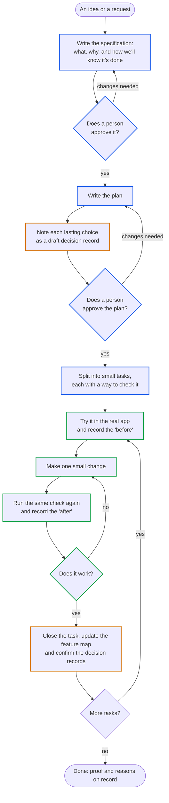
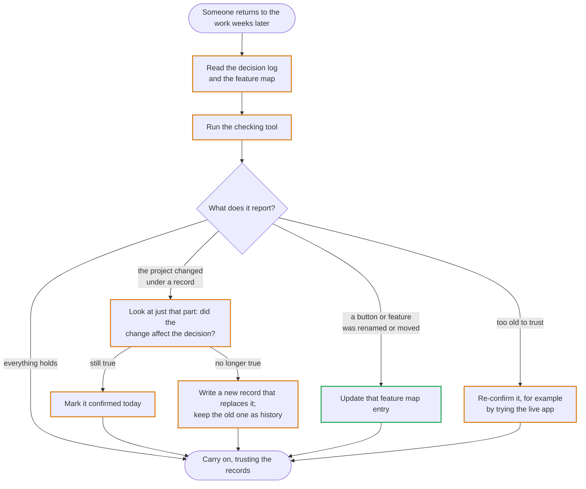

# How our three AI coding skills work together

As of 2026-11-25.

## The short version

Three add-ons ("skills") for an AI coding assistant work as one team: one makes the assistant **plan before it builds**, one makes it **prove the result works**, and one makes it **remember why things were done**, and notice when that memory is out of date.

Without them, an AI assistant tends to fail in three familiar ways. It starts building before anyone agreed what "done" means. It says "fixed" without ever trying the app the way a user would. And when someone returns to the work weeks later, the reasons behind earlier choices are lost, so old debates start again or old notes are trusted after they stopped being true.

| Skill | Its job in one line |
| --- | --- |
| **Spec-Driven Development** | Agree on what to build, and how we'll know it's done, before any work starts |
| **Feature Map** | Try the change in the real app, before and after, and keep a map of where each feature lives |
| **Anchored Decisions** | Write down why each important choice was made, and check automatically whether it still holds |

## An everyday comparison: renovating a house

Think of the AI assistant as a builder renovating your house. The three skills are the paperwork every good renovation has.

- **The plan you sign before work starts** is Spec-Driven Development. You agree on what the new kitchen looks like, what's out of scope this time, and how you'll judge it finished. The builder doesn't pick up a tool until you've signed it.
- **The inspection, plus a floor plan** is Feature Map. When the builder says the tap is fixed, the inspector turns it on and watches the water run, before and after. The floor plan shows where every pipe and switch is, so the next person finds them without knocking down walls.
- **The house logbook** is Anchored Decisions. It records why the wiring runs behind the left wall and why the cheaper option was rejected. Each entry also says which parts of the house it depends on, so if someone moves that wall later, the logbook flags the entry as "check this again" instead of quietly going wrong.

Each piece of paperwork is useful on its own. Together, they mean nothing is built without agreement, nothing is called finished without proof, and no reason is forgotten.

## What each skill does

Each skill leaves behind one plain text document that people and the assistant can both read.

### Spec-Driven Development: agree first, then build

Published by Addy Osmani. Before any work starts, the assistant writes a short **specification**: what we're building and why, who it's for, what's off limits, and the checks that prove it's finished. It lists its own assumptions so a person can correct them early, then stops and waits for approval.

Only after approval does it write a **plan**, then a list of small **tasks**, each with a way to check it, again pausing for a person to review each step. New ideas that arrive mid-way go on a "later" list instead of quietly growing the job.

**Leaves behind:** the specification and the task list.

### Feature Map: show it works, and know where things are

When the assistant fixes or builds something, it must **reproduce the problem in the real app first**, the way a user would see it, then make a small change and **run exactly the same check again**. It reports the before and after as evidence, not as a claim.

If it can't run the check, for example because it wasn't given permission, it never sneaks around that. It labels its report **PARTIAL VERIFICATION** or **UNVERIFIED** and lists the steps a person needs to finish checking.

It also keeps a **feature map**: for each feature, where its code lives, how a user reaches it on screen, and the names of the buttons and panels it uses. When the assistant keeps making the same kind of mistake, it turns that lesson into an automatic rule the project enforces from then on.

**Leaves behind:** the feature map and a before/after report for each change.

### Anchored Decisions: remember why, and notice when it stops being true

Every important choice becomes a short **decision record**: the rule, the reason, the alternative that was turned down and why, and the date it was last confirmed. That turned-down option matters most: it is the one thing nothing else records, and without it the same debate happens again.

Each record is **anchored** to the specific parts of the project it depends on. A small checking tool reads every record and every anchor and reports in seconds which ones still hold, which ones the project has changed underneath, and which are old enough to re-confirm. It can block a change from being saved while a record is out of date.

The same tool also checks the feature map, so if a button is renamed or a feature moves, the map is flagged too.

**Leaves behind:** the decision log.

## How they work together on one piece of work

The skills take turns: Spec-Driven Development leads until the plan is approved, Feature Map leads while each task is built and checked, and Anchored Decisions records the reasons at both ends.

Blue outlines are Spec-Driven Development, green are Feature Map, and orange are Anchored Decisions.

Three hand-offs make the team work:

1. **Plan to decisions.** When the plan settles a choice that should outlast this job (say, "payments always go through one provider"), it becomes a draft decision record, with the option that was turned down. It becomes official when a person approves the plan.
2. **Tasks to the feature map.** Each task's "how to check it" points at the feature map, so the assistant knows exactly which screen to open and which button to press.
3. **Proof to the record.** How thoroughly the change was checked is written into the decision record. A full before-and-after run counts as confirmed; a partial check is noted as partial; an unchecked change leaves the decision as a draft.

## Coming back later

When someone (a person or the assistant) returns to the work weeks later, the checking tool tells them in seconds which notes they can trust, so they only re-examine what actually changed.

Most returns stop at the first step: read the notes, run the check, see that everything holds, and carry on. That takes about two minutes instead of re-discovering everything from scratch.

Two rules keep this trustworthy:

- **Never delete a decision.** When one stops being true, a new record replaces it and the old one stays as history. The old record is where the "why we didn't do it the other way" lives.
- **Fix the notes in the same change as the work.** The same check can run automatically every time someone saves their work, and stop the save while a record is out of date. Notes can't quietly fall behind.

## What they don't do

None of the three makes the assistant smarter on its own; they make its work agreed, proven and remembered.

| Skill | Limits to know about |
| --- | --- |
| **Spec-Driven Development** | Keeping the specification up to date is a rule the assistant follows, not something checked automatically. It adds approval pauses, so it's skipped for tiny, obvious fixes. |
| **Feature Map** | In its own tests, assistants fixed every problem with or without it; what it improved was the quality of the evidence. Trying the real app takes time and tools, and some environments don't allow it. Those tests were run before the skill was translated from Spanish to English and haven't been repeated. |
| **Anchored Decisions** | The checking tool can tell that a part of the project changed or disappeared, not whether the decision is still wise. Any change to an anchored part raises a flag, even an unrelated one, so busy areas need frequent re-confirming. Someone still has to write each record when the choice is made. |

The feature map is only partly checked: the tool confirms each feature's location and its button and panel names still exist, but not the on-screen route a user follows.

## Glossary

| Word | Meaning here |
| --- | --- |
| **AI coding assistant** | An AI (such as Claude Code) that reads and changes a software project on request |
| **Skill** | A written set of instructions the assistant loads to work in a particular way |
| **Specification (spec)** | The agreed description of what to build, why, and how to tell it's finished |
| **Task** | One small, checkable step of the plan |
| **Feature map** | A document listing, for each feature, where it lives, how a user reaches it, and the names of its buttons and panels |
| **Decision record** | A short note of one choice: the rule, the reason, the rejected alternative, and when it was last confirmed |
| **Anchor** | A pointer from a decision record to the exact part of the project it depends on, which lets the tool notice when that part changes |
| **Checking tool** | The small program (`anchor-check`) that reads every record and the feature map and reports what still holds |
| **Guardrail** | An automatic rule that stops a known mistake from being made again |

## Where to find them

- Spec-Driven Development: [skills.sh/addyosmani/agent-skills/spec-driven-development](https://skills.sh/addyosmani/agent-skills/spec-driven-development)
- Feature Map: [github.com/nicoliniyo/feature-map](https://github.com/nicoliniyo/feature-map) (v1.0.0)
- Anchored Decisions: [github.com/nicoliniyo/anchored-decisions](https://github.com/nicoliniyo/anchored-decisions) (v1.2.0)

A more technical comparison, including Kiro's spec-driven development, is in [`kiro-comparison.md`](kiro-comparison.md).
